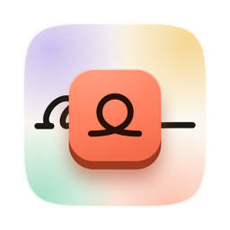
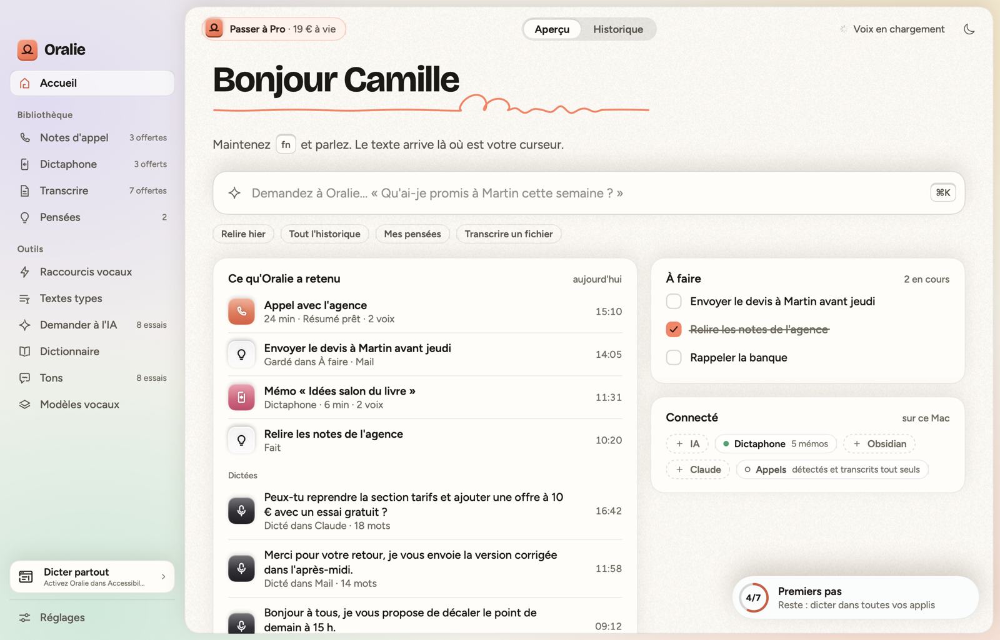
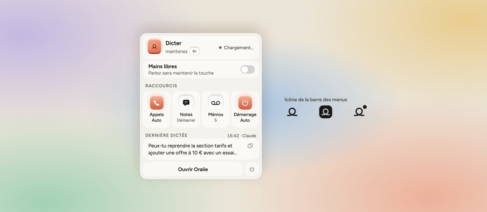

  

<h1 align="center">Oralie</h1>

<b>Parlez, c'est écrit.</b> 
Maintenez une touche, parlez, relâchez : le texte s'écrit là où est votre curseur, dans n'importe quelle appli.

  <a href="https://github.com/sileeex/oralie/releases/latest/download/Oralie.dmg"><b>⬇︎ Télécharger pour Mac</b></a>
  &nbsp;·&nbsp;
  <a href="https://github.com/sileeex/oralie/releases/latest/download/Oralie-Windows-setup.exe"><b>⬇︎ Télécharger pour Windows</b></a> <i>(version d'essai)</i>

Gratuit · dictée illimitée · tout reste sur votre ordinateur

  

## Pourquoi Oralie

- **Simple.** On installe, on maintient `fn`, on parle. Rien à configurer.
- **Rapide.** Le texte arrive environ une seconde après avoir relâché la touche (mesuré sur un MacBook Pro à puce Apple).
- **Privé.** La voix est transcrite sur votre Mac. Rien n'est envoyé sur Internet.
- **Partout.** Mail, Messages, Notes, Word, Slack, votre navigateur… là où il y a un curseur.
- **Prêt à l'emploi.** Raccourcis vocaux (« cherche sur Google… », « ouvre Notes »), textes types (« ma signature »), ponctuation dite à voix haute, plusieurs langues.

Et aussi, à essayer gratuitement dans l'appli : transcription de fichiers audio et vidéo, mémos du Dictaphone de l'iPhone transcrits tout seuls, notes d'appel avec résumé, tons adaptés à chaque appli.

  

## Installer sur Mac

1. Téléchargez **Oralie.dmg**, ouvrez-le et glissez Oralie dans **Applications**.
2. Au premier lancement, si le Mac affiche « Apple ne peut pas vérifier Oralie » : ouvrez **Réglages Système › Confidentialité et sécurité**, descendez et cliquez sur **Ouvrir quand même**. (Oralie n'est pas encore signée par Apple, c'est en cours.)
3. Suivez la bienvenue : autorisez le **micro** et l'**Accessibilité** (pour écrire dans vos applis), puis maintenez `fn` et parlez.

Il faut un Mac à puce Apple (M1 ou plus récent) et macOS 14 ou plus récent.

## Installer sur Windows (version d'essai)

1. Téléchargez **Oralie-Windows-setup.exe** et lancez-le.
2. Si Windows affiche « Windows a protégé votre ordinateur » : cliquez sur **Informations complémentaires**, puis **Exécuter quand même**.
3. Choisissez votre modèle de voix dans la bienvenue (un modèle léger est conseillé sur les PC plus anciens).

Windows 10 ou 11. La version Windows est toute neuve : vos retours sont précieux.

## Un souci, une idée ?

Ouvrez une [discussion ou un signalement](https://github.com/sileeex/oralie/issues) : chaque retour est lu.
